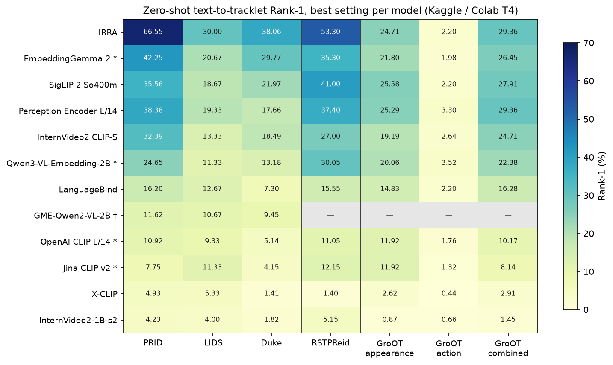
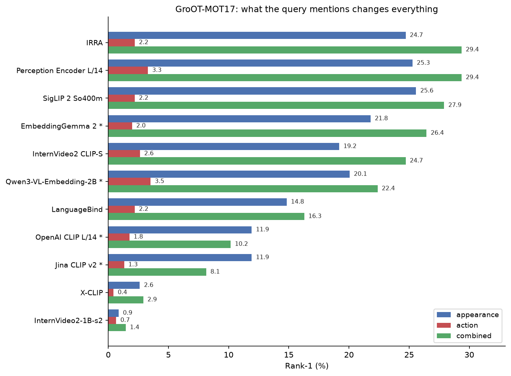
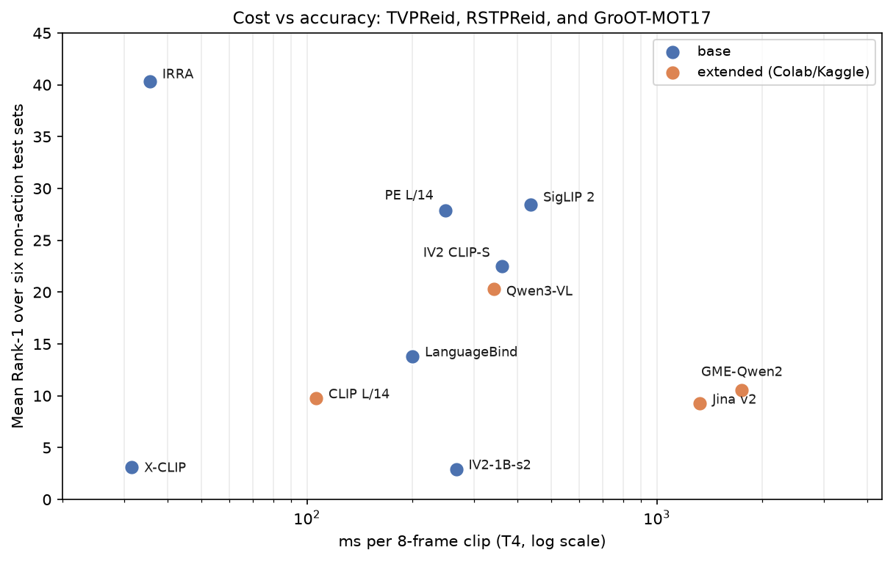

# SHAWAF: text-to-tracklet retrieval

Frozen **text ↔ tracklet** retrieval: encode a caption and each gallery tracklet
with a vision-language model, rank by cosine similarity. No Re-ID fusion in
Stage 1. Optional [Gradio demo](demo/app.py) and Qdrant indexing for search.

```text
text ──► text encoder ──► query vector ──► cosine rank ──► gallery tracklets
tracklet frames ──► image/video encoder ──► tracklet vector ──┘
```

## At a glance

| Goal | Model to use |
|------|----------------|
| Best person-search accuracy | **IRRA** |
| Best general VLM on TVPReid (no IRRA) | **EmbeddingGemma 2** † |
| **Default demo / balanced baseline** | **Perception Encoder L/14** (`pe_core_l14`) |
| Image / appearance-heavy queries | **SigLIP 2** |
| Long video, paragraph events | **InternVideo2 CLIP-S** |

† Separate install: `pip install -e ".[embeddinggemma2]"` and
[`notebooks/embeddinggemma2_tier_a_zero_shot.ipynb`](notebooks/embeddinggemma2_tier_a_zero_shot.ipynb).
Duke window protocol still in progress; see
[`results/checkpoints/embeddinggemma2_tier_a_v1.csv`](results/checkpoints/embeddinggemma2_tier_a_v1.csv).

All numbers below are **zero-shot**, **Rank-1 / mAP**, best protocol and pool
per cell unless noted. **How frames, windows, and pooling work:**
[`docs/retrieval_protocol_and_pooling.md`](docs/retrieval_protocol_and_pooling.md).

## Tier-A leaderboard (ranked)

### TVPReid (video tracklets)

Gallery: PRID 185 · iLIDS 75 · Duke 603 tracklets.

| Rank | Model | PRID | iLIDS | Duke |
|:---:|---|---:|---:|---:|
| 1 | **IRRA** | **66.55 / 76.09** | **30.00 / 41.29** | **38.06 / 50.79** |
| 2 | EmbeddingGemma 2 † | **42.25 / 55.52** | 20.67 / 32.48 | **29.77 / 39.48** |
| 3 | Perception Encoder L/14 | 38.38 / 52.04 | 19.33 / 32.55 | 17.66 / 28.12 |
| 4 | SigLIP 2 So400m | 35.56 / 50.84 | 18.67 / 28.88 | 21.97 / 33.03 |
| 5 | InternVideo2 CLIP-S | 32.39 / 43.77 | 13.33 / 24.14 | 18.49 / 28.36 |

IRRA is task-trained for text-to-person retrieval. General VLMs lag on identity
fine detail; EmbeddingGemma 2 leads that group on our Tier-A run.



### RSTPReid (still images)

| Rank | Model | Rank-1 / mAP |
|:---:|---|---:|
| 1 | **IRRA** | **53.30 / 39.71** |
| 2 | SigLIP 2 So400m | 41.00 / 29.34 |
| 3 | Perception Encoder L/14 | 37.40 / 29.09 |
| 4 | EmbeddingGemma 2 † | 35.30 / 24.97 |
| 5 | InternVideo2 CLIP-S | 27.00 / 21.34 |

### GroOT-MOT17 (appearance · action · combined)

| Rank | Model | Appearance | Action | Combined |
|:---:|---|---:|---:|---:|
| 1 | Perception Encoder L/14 | 25.29 | 3.30 | **29.36** |
| 1 | IRRA | 24.71 | 2.20 | **29.36** |
| 2 | SigLIP 2 So400m | **25.58** | 2.20 | 27.91 |
| 3 | EmbeddingGemma 2 † | 21.80 | 1.98 | 26.45 |
| 4 | InternVideo2 CLIP-S | 19.19 | 2.64 | 24.71 |

Action scores stay low (repetitive captions — dataset ceiling, not model quality).



### ActivityNet Captions (transfer check, 1k `val1` sample)

| Model | Paragraph | Sentence | Mean Rank-1 |
|---|---:|---:|---:|
| InternVideo2 CLIP-S | **69.80 / 80.24** | 39.73 / 52.87 | 54.76 |
| Perception Encoder L/14 | 68.10 / 78.87 | **41.91 / 54.83** | **55.01** |
| SigLIP 2 So400m | 57.10 / 70.18 | 35.11 / 48.51 | 46.11 |

Not published ActivityNet numbers — frozen encoders on a fixed sample.

### Cost vs accuracy (Tier-A)



Mean Rank-1 over TVPReid (3), RSTPReid, GroOT appearance + combined (action
excluded). Regenerate figures: `python scripts/make_figures.py`.

**All models (including X-CLIP, LanguageBind, extended VLMs, and partial runs):**
[`docs/full_benchmark_scores.md`](docs/full_benchmark_scores.md) and the
checkpoint CSVs under `results/checkpoints/`.

## Demo (Gradio)

**Default encoder: Perception Encoder L/14** (`pe_core_l14`) — strong across
TVPReid, RSTPReid, and GroOT without a large drop on any one benchmark (unlike
specialists that win one split and collapse elsewhere). The UI picks the first
indexed model in this order: `pe_core_l14` → `irra` → `siglip2`, or set
`SHAWAF_DEMO_MODEL=pe_core_l14` explicitly.

```bash
pip install -e ".[demo]"
python scripts/download_tier_a.py
python scripts/prepare_local_annotations.py   # optional: repo Annotations/
python scripts/index_qdrant.py --model pe_core_l14 --dataset tvpreid:prid --skip-qdrant
python demo/app.py
```

Local annotations: `--dataset local:all` after indexing with the same `--model`.
Data download is CLI-only (not in the UI). See [docs/datasets_catalog.md](docs/datasets_catalog.md).

## Install & evaluate

```bash
pip install -e ".[all]"          # base benchmark models
pip install -e ".[embeddinggemma2]"  # EmbeddingGemma 2 only (do not mix with [all] in one env)
```

```bash
python scripts/eval_encoder.py --model pe_core_l14 --windows --pools mean,query_max,global_local
```

Pooling (Type A / B / C): see
[`docs/retrieval_protocol_and_pooling.md`](docs/retrieval_protocol_and_pooling.md).

## Repository

| Path | Purpose |
|---|---|
| [`shawaf_vlm/`](shawaf_vlm/) | Library: data, models, retrieval, eval |
| [`scripts/`](scripts/README.md) | Download, index, figures, annotations prep |
| [`notebooks/`](notebooks/) | Kaggle/Colab benchmarks |
| [`docs/`](docs/ARCHITECTURE.md) | [Protocol & pooling](docs/retrieval_protocol_and_pooling.md), [full scores](docs/full_benchmark_scores.md), [environments](docs/ENVIRONMENTS.md) |

**Notebooks:** [`kaggle-zero-shot.ipynb`](notebooks/kaggle-zero-shot.ipynb) (base group),
[`embeddinggemma2_tier_a_zero_shot.ipynb`](notebooks/embeddinggemma2_tier_a_zero_shot.ipynb),
[`colab_extended_zero_shot.ipynb`](notebooks/colab_extended_zero_shot.ipynb) (extra VLMs).

## Limitations

Zero-shot only; protocol and pool affect scores. GroOT action captions are
repetitive. EmbeddingGemma Duke `reid_8fps_n64` pending. TV-MARS captions are
gated — use the dataset agreement, do not commit caption files.

## License

See [`LICENSE`](LICENSE). Dataset and checkpoint licenses remain with their
providers.
